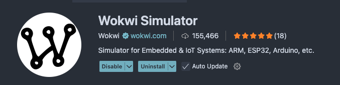
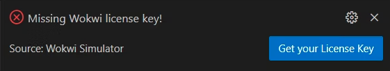
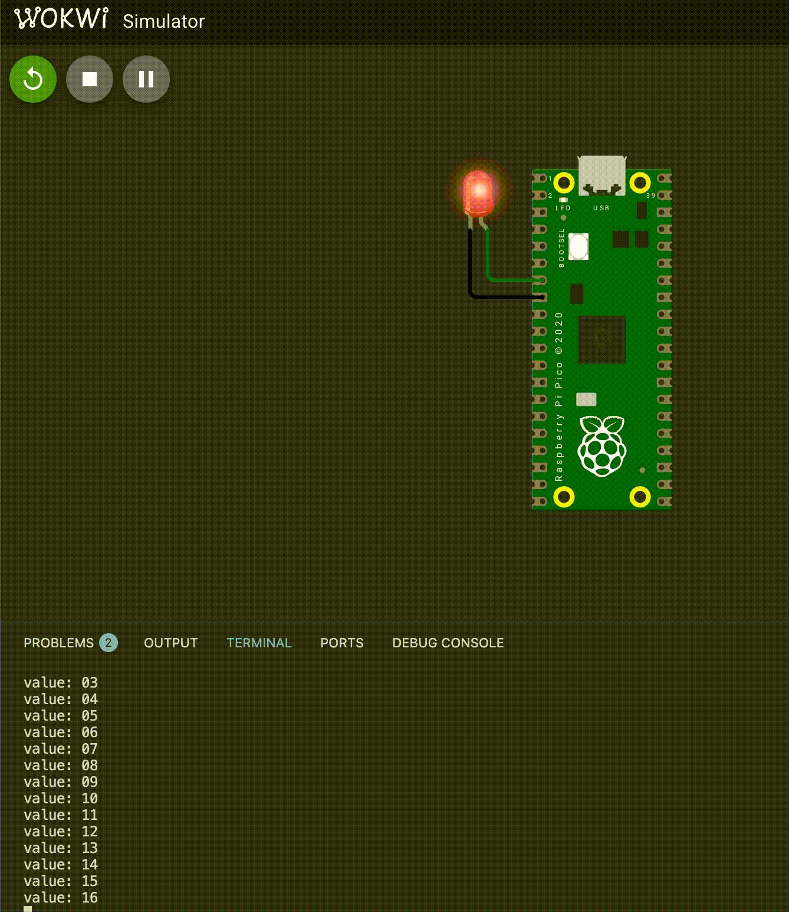

# 準備
[Wokwi](https://wokwi.com/) というシミュレータを使います。

次のリポジトリをCloneして、移動しておきましょう。個人のアカウントでこのリポジトリをForkして、Cloneしてもいいです。

```
git clone https://github.com/nnct-jo-ken/pico-wokwi-playground.git
cd pico-wokwi-playground/hello-blinky-rs
```

## 拡張機能インストール
次にVSCodeの拡張機能として、Wokwiをインストールします。


以下のコマンドを一つずつ入力して、必要なものをインストールします。

```
cargo install probe-rs-tools
cargo install flip-link
cargo install elf2uf2-rs
rustup target add thumbv6m-none-eabi
```

注）`Cmake`が入っていなければインストールします。

## シミュレータ起動

まずはソースコードをビルドしておきます。

```
cargo build
elf2uf2-rs target/thumbv6m-none-eabi/debug/pico-wokwi-playground
```

`Ctrl+Shift+P`でコマンドパレットを起動し、`Wokwi: Start Simulator` を選択します。
しかし、`Missing Wokwi license key!`（ライセンスキーがないよ！）と言われていることがわかります。


`Get your License Key` をクリックして、GitHubアカウントでライセンス登録をしましょう。


ここまで完了したら、再度 `Ctrl+Shift+P`でシミュレータを起動してみましょう。（VSCodeの再起動が必要な人もいるかもしれません。）



## ソースコードを確認
どのようなコードが書かれているか、確認してみましょう。

```rs
#![no_main]
#![no_std]

// Hardware Abstraction Layer
use rp_pico::hal;
// periheral access crate
use hal::pac;

use panic_halt as _;

// traits
use core::fmt::Write;
use embedded_hal::delay::DelayNs;
use embedded_hal::digital::StatefulOutputPin;
use hal::clocks::Clock;
use hal::fugit::RateExtU32;

use hal::uart::*;

#[hal::entry]
fn main() -> ! {
    let mut pac = pac::Peripherals::take().unwrap();

    // Set up the watchdog driver - needed by the clock setup code
    let mut watchdog = hal::Watchdog::new(pac.WATCHDOG);

    // Configure the clocks
    let clocks = hal::clocks::init_clocks_and_plls(
        rp_pico::XOSC_CRYSTAL_FREQ,
        pac.XOSC,
        pac.CLOCKS,
        pac.PLL_SYS,
        pac.PLL_USB,
        &mut pac.RESETS,
        &mut watchdog,
    )
    .unwrap();

    let mut timer = hal::timer::Timer::new(pac.TIMER, &mut pac.RESETS, &clocks);

    // The single-cycle I/O block controls our GPIO pins
    let sio = hal::Sio::new(pac.SIO);

    // Set the pins to their default state
    let pins = hal::gpio::Pins::new(
        pac.IO_BANK0,
        pac.PADS_BANK0,
        sio.gpio_bank0,
        &mut pac.RESETS,
    );

    let mut led_pin = pins.gpio5.into_push_pull_output();

    let uart_pins = (
        // UART TX (characters sent from RP2040) on pin 1 (GPIO0)
        pins.gpio0.into_function(),
        // UART RX (characters received by RP2040) on pin 2 (GPIO1)
        pins.gpio1.into_function(),
    );
    let mut uart = hal::uart::UartPeripheral::new(pac.UART0, uart_pins, &mut pac.RESETS)
        .enable(
            UartConfig::new(9600.Hz(), DataBits::Eight, None, StopBits::One),
            clocks.peripheral_clock.freq(),
        )
        .unwrap();

    writeln!(uart, "Hello, world!\r").unwrap();

    let mut value = 0u32;
    loop {
        led_pin.toggle().unwrap();
        writeln!(uart, "value: {value:02}\r").unwrap();
        timer.delay_ms(500);
        value += 1
    }
}
```

注目するコードは、50行目あたりの `led_pin` の宣言と、70行目あたりです。
`.gpio5`や`.toggle()`といったメンバやメソッドがあるのがわかります。

```rs
    ...
    let mut led_pin = pins.gpio5.into_push_pull_output();
    ...
    loop {
        led_pin.toggle().unwrap();
        ...
    }
```

これらはなんでしょうか。考えてみてください。

ヒント1：`diagram.json`を確認する  
ヒント2：[embedded_hal(docs.rs)](https://docs.rs/embedded-hal/1.0.0/embedded_hal/)を確認する
