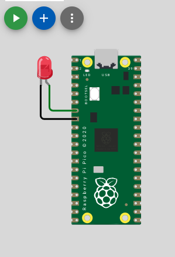
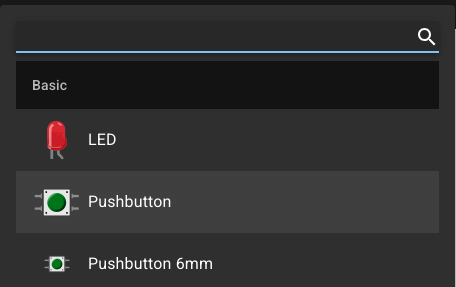

# ボタンを押したときにLEDを光らせよう

## ボタンを追加

[Wokwiエディタ](https://wokwi.com/projects/new/pi-pico)を開いて、
手元にある`diagram.json`をWokwiエディタ側に一度コピペしましょう。


そしたら、次に色の`+`ボタンを押して、ボタン(`Pushbutton`)を追加します。



今回は、緑ボタンの上の線（`1.r`）をGPIO9に、その下の線（`2.r`）をGNDに繋ぎます。
そしたら、Wokwiエディタにある`diagram.json` を手元のそれにコピペしましょう。
VSCode側の描画も変わったことが確認できると思います。

## プログラム

さて、もしボタンが押されたら、LEDを点灯する」というプログラムを書いてみましょう。

<details><summary>解答例:コードを書いてから答えをみよう！</summary><div>

```rs
    ...
    let mut led_pin = pins.gpio5.into_push_pull_output();
    let mut green_button = pins.gpio9.into_pull_up_input();
    ...
    loop {
        if green_button.is_low().unwrap() {
            led_pin.set_high().unwrap();
        }
        ...
    }
```

</div></details>

### 解説

`.into_pull_up_input()`と`.into_push_pull_output()`の違いはなんでしょうか。

マイコンの入力ピンは、電圧がHIGHかLOWかを読み取ります。しかし、ピンが何も繋がっていないと、電圧が決まりません（浮いていると表現されます）。
そこで、内部抵抗でHIGHに繋いでおくことで、何も繋がっていない時はHIGH、ボタンが押された時はLOWを検出できます。

マイコンの出力ピンは、電圧をHIGHかLOWを出力します。

- `.into_pull_up_input()` : ピンを入力として使うときに設定
- `.into_push_pull_output()` : ピンを出力とし使うときに設定

### 挑戦！

3つのボタンと2つのLEDを用意して、以下の機能を実装してみよう
- ボタンはそれぞれ赤色ボタン、青色ボタン、リセットボタン用
- 赤色ボタンを押したら、赤色LEDが点灯
- 青色ボタンを押したら、青色LEDが点灯
- リセットボタンが押されたら、点灯しているLEDが消灯

ヒント1：diagram.json` を編集して、各ボタン・LEDの追加が必要  
ヒント2：ボタンが押されている状態を持つ変数が別途必要